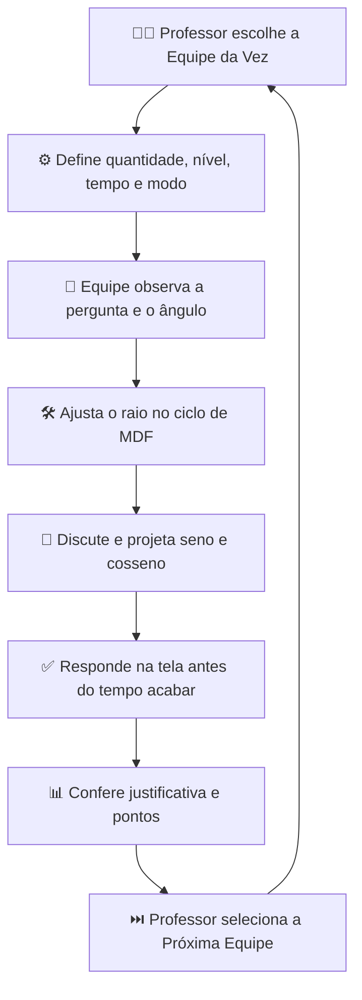

<p align="center">
  
  
  
</p>

<p align="center">
  
  
  
  
</p>

<!-- FIGURA DO CICLO TRIGONOMÉTRICO EM SVG -->
<p align="center">
<svg width="420" height="460" viewBox="0 0 480 520" role="img" aria-labelledby="titulo-ciclo descricao-ciclo" xmlns="http://www.w3.org/2000/svg">
  <title id="titulo-ciclo">Ciclo Trigonométrico</title>
  <desc id="descricao-ciclo">Círculo unitário com raio 1, eixos X e Y, ângulo de 45 graus, projeções do seno e do cosseno e quadrantes numerados fora do círculo.</desc>

  <!-- Fundo -->
  <rect x="0" y="0" width="480" height="520" rx="24" fill="#F2F8FF" stroke="#0B2D5A" stroke-width="3"/>

  <!-- Título da figura -->
  <text x="240" y="42" text-anchor="middle" font-family="Arial, sans-serif" font-size="24" font-weight="bold" fill="#0B2D5A">CICLO TRIGONOMÉTRICO</text>
  <text x="240" y="68" text-anchor="middle" font-family="Arial, sans-serif" font-size="15" fill="#0B2D5A">R = 1 • sen • cos • tg</text>

  <!-- Definição do recorte do círculo -->
  <defs>
    <clipPath id="recorteCirculo">
      <circle cx="240" cy="280" r="160" />
    </clipPath>
  </defs>

  <!-- Fundo dos quadrantes DENTRO do círculo, clipado para não vazar -->
  <g clip-path="url(#recorteCirculo)">
    <rect x="240" y="120" width="160" height="160" fill="#D9F7E8" />
    <rect x="80" y="120" width="160" height="160" fill="#D6EDFF" />
    <rect x="80" y="280" width="160" height="160" fill="#FFE8F1" />
    <rect x="240" y="280" width="160" height="160" fill="#FFF6CC" />
  </g>

  <!-- Eixo da tangente x = 1 -->
  <line x1="400" y1="90" x2="400" y2="470" stroke="#FF6B00" stroke-width="2" stroke-dasharray="8 6" />
  <text x="410" y="110" font-family="Arial, sans-serif" font-size="13" font-weight="bold" fill="#FF6B00">eixo tg</text>
  <text x="410" y="128" font-family="Arial, sans-serif" font-size="13" fill="#FF6B00">x = 1</text>

  <!-- Eixos X e Y -->
  <line x1="60" y1="280" x2="430" y2="280" stroke="#0B2D5A" stroke-width="3" />
  <line x1="240" y1="100" x2="240" y2="460" stroke="#0B2D5A" stroke-width="3" />
  <text x="435" y="275" font-family="Arial, sans-serif" font-size="15" font-weight="bold" fill="#0B2D5A">X</text>
  <text x="248" y="105" font-family="Arial, sans-serif" font-size="15" font-weight="bold" fill="#0B2D5A">Y</text>
  <text x="248" y="298" font-family="Arial, sans-serif" font-size="13" fill="#0B2D5A">0</text>

  <!-- Círculo -->
  <circle cx="240" cy="280" r="160" fill="none" stroke="#0B2D5A" stroke-width="4" />

  <!-- Projeções do ponto de 45 graus -->
  <!-- Ponto P = (353, 167) para 45 graus -->
  <line x1="353" y1="167" x2="353" y2="280" stroke="#00C6FB" stroke-width="3" stroke-dasharray="7 5" />
  <line x1="353" y1="167" x2="240" y2="167" stroke="#00E676" stroke-width="3" stroke-dasharray="7 5" />

  <!-- Raio -->
  <line x1="240" y1="280" x2="353" y2="167" stroke="#0B2D5A" stroke-width="4" stroke-linecap="round" />
  <circle cx="353" cy="167" r="8" fill="#0B2D5A" />
  <text x="360" y="160" font-family="Arial, sans-serif" font-size="14" font-weight="bold" fill="#0B2D5A">P</text>
  <text x="285" y="215" font-family="Arial, sans-serif" font-size="14" font-weight="bold" fill="#0B2D5A">R = 1</text>

  <!-- Arco do ângulo -->
  <path d="M 300 280 A 60 60 0 0 0 282 237" fill="none" stroke="#FF0000" stroke-width="3" />
  <text x="302" y="262" font-family="Arial, sans-serif" font-size="14" font-weight="bold" fill="#FF0000">45°</text>

  <!-- Legendas das projeções -->
  <text x="300" y="305" font-family="Arial, sans-serif" font-size="13" font-weight="bold" fill="#0077B6">cos 45°</text>
  <text x="130" y="195" font-family="Arial, sans-serif" font-size="13" font-weight="bold" fill="#008000">sen 45°</text>

  <!-- Números dos quadrantes FORA do círculo -->
  <text x="410" y="150" text-anchor="middle" font-family="Arial, sans-serif" font-size="18" font-weight="bold" fill="#0B2D5A">1º</text>
  <text x="410" y="172" text-anchor="middle" font-family="Arial, sans-serif" font-size="12" fill="#0B2D5A">Quadrante</text>

  <text x="70" y="150" text-anchor="middle" font-family="Arial, sans-serif" font-size="18" font-weight="bold" fill="#0B2D5A">2º</text>
  <text x="70" y="172" text-anchor="middle" font-family="Arial, sans-serif" font-size="12" fill="#0B2D5A">Quadrante</text>

  <text x="70" y="430" text-anchor="middle" font-family="Arial, sans-serif" font-size="18" font-weight="bold" fill="#0B2D5A">3º</text>
  <text x="70" y="452" text-anchor="middle" font-family="Arial, sans-serif" font-size="12" fill="#0B2D5A">Quadrante</text>

  <text x="410" y="430" text-anchor="middle" font-family="Arial, sans-serif" font-size="18" font-weight="bold" fill="#0B2D5A">4º</text>
  <text x="410" y="452" text-anchor="middle" font-family="Arial, sans-serif" font-size="12" fill="#0B2D5A">Quadrante</text>

  <!-- Rodapé da figura -->
  <text x="240" y="492" text-anchor="middle" font-family="Arial, sans-serif" font-size="13" fill="#0B2D5A">P = (cos θ, sen θ) • tg = sen / cos</text>
</svg>
</p>

<p align="center">
  <i>Figura 1 - Ciclo trigonométrico com raio unitário, projeções de seno e cosseno e quadrantes numerados.</i>
</p>

<h1 align="center">📐 Estação Trigonométrica: Desafio do Ciclo Maker</h1>
<h3 align="center">📖 Manual de Uso</h3>

<p align="center">
  Manual didático e ilustrativo para utilizar a Estação Trigonométrica na sala de aula, no Laboratório Maker.
</p>

<p align="center">
  🏫 <b>EEB Frederico Hardt | Indaial/SC</b><br/>
  👨‍🏫 <b>Prof. Wilder Paz Barros Cruz</b> e 👩‍🏫 <b> Prof. Cristiane Santos</b><br/>
  🖥️ Tela Interativa | 💻 Tablets/Chromebooks | 🛠️ Ciclo Físico em MDF
</p>

---

## 📚 Sobre a Estação

A **Estação Trigonométrica** é uma estação gamificada para aprender e consolidar o ciclo trigonométrico, com foco em **seno, cosseno e tangente**.

Em vez de um questionário estático, a dinâmica combina:

| 🎯 Recurso | ✨ O que acontece |
| :--- | :--- |
| 🖥️ **Tela Interativa** | Exibe o ciclo, a pergunta, o cronômetro e o placar |
| 👥 **Discussão em equipe** | Os estudantes discutem e decidem juntos |
| 🛠️ **Ciclo Físico em MDF** | Raio móvel de 100 mm para validar na bancada |
| ⏱️ **Resposta rápida** | Tempo, pontos e bônus por justificativa oral |

> 💡 **Ideia central:** observar o ângulo, ajustar o raio, projetar os eixos, discutir em equipe e responder antes do tempo acabar.

---

## 👥 Para quem é este manual

| 👤 Público | 📖 O que aprende |
| :--- | :--- |
| 👨‍🏫 **Professor** | Criar equipes, configurar a rodada, escolher a equipe da vez, controlar o tempo, dar bônus e gerenciar o placar |
| 👩‍🎓 **Aluno** | Observar, ajustar o raio no MDF, verificar o quadrante, projetar os eixos e responder em equipe |

---

## 🔄 Como funciona a dinâmica



A atividade acontece na **tela interativa, com uma equipe por vez**.

1.  👨‍🏫 O professor escolhe a equipe da vez
2.  ⚙️ Define quantidade de questões, nível, tempo por questão e modo
3.  👀 A equipe observa a pergunta e o ângulo
4.  🛠️ Ajusta o raio de 100 mm no ciclo de MDF
5.  💬 Discute e projeta seno no eixo Y e cosseno no eixo X
6.  ✅ Responde na tela antes do tempo acabar
7.  📊 Confere a justificativa com o mini ciclo
8.  ⏭️ Ao final, o professor seleciona a próxima equipe

---

## 🧩 O que a aplicação contém

### 📐 Aprender - Ciclo Interativo
- 🔄 Raio arrastável e slider de 0° a 360°
- ⚡ Botões de ângulos rápidos
- 📈 Projeções, eixo da tangente e triângulo retângulo
- 🧮 Identidade fundamental: `sen²(θ) + cos²(θ) = 1`
- 🗺️ Sinais por quadrante e redução ao 1º quadrante

### ❓ Quiz - 45 Questões
- 🟢 **15 Básicas**
- 🟡 **15 Médias**
- 🔴 **15 Avançadas**
- ⏱️ Cronômetro, feedback imediato e justificativa visual

### ⚡ Relâmpago
- ⏱️ Tempo padrão de **30 segundos**, configurável de 5s a 60s
- 🔢 Quantidade padrão de **5 questões**
- ✖️ Multiplicador **x2** para acertos seguidos

### 🏆 Professor / Placar
- 👥 Criação e edição de equipes
- 🎨 Cores nomeadas e nomes dos estudantes
- ⚙️ Configuração do Relâmpago
- ➕ Bônus de justificativa oral **+30**
- 🏅 Pódio e histórico completo

### 🛠️ Validador MDF
- 📋 Passo a passo para usar o ciclo físico
- ✅ Checklist de validação

### ♿ Acessibilidade - DUA
- 🔊 Leitura em voz alta
- ⌨️ Navegação por teclado
- 🌓 Alto contraste e aumento de texto
- 🎞️ Redução de animações
- 📝 Feedback sempre com texto + ícone, nunca só com cor

---

## 👥 Equipes

As equipes pré-criadas são **Alfa** e **Beta**.

No módulo **Professor / Placar**, o professor pode:

- ✏️ Editar o nome da equipe
- 👩‍🎓 Inserir os nomes dos estudantes, separados por vírgula
- 🎨 Escolher a cor da equipe
- 💾 Salvar os nomes para aparecerem no card, no placar, na equipe da vez e no histórico

### 🎨 Cores disponíveis

| Cor | Amostra |
| :--- | :--- |
| 🟣 **Roxo** | [Roxo](https://img.shields.io/badge/-Roxo-800080?style=flat-square) |
| ⬜ **Cinza** | [Cinza](https://img.shields.io/badge/-Cinza-808080?style=flat-square) |
| 🟡 **Amarelo** | [Amarelo](https://img.shields.io/badge/-Amarelo-FFD700?style=flat-square) |
| 🟢 **Verde** | [Verde](https://img.shields.io/badge/-Verde-00E676?style=flat-square) |
| 🩷 **Rosa** | [Rosa](https://img.shields.io/badge/-Rosa-FF69B4?style=flat-square) |
| 🔵 **Azul** | [Azul](https://img.shields.io/badge/-Azul-00C6FB?style=flat-square) |
| 🔴 **Vermelho** | [Vermelho](https://img.shields.io/badge/-Vermelho-FF0000?style=flat-square) |

> ℹ️ **Reiniciar somente o placar** preserva os nomes e o histórico.  
> ⚠️ **Reiniciar a partida completa** apaga tudo somente após confirmação.

---

## 🏆 Pontuação

| Ação | Pontos |
| :--- | :--- |
| ✅ Acerto | **+100 pontos** |
| ⚡ Bônus por velocidade | Até **+50 pontos** |
| 🗣️ Bônus por justificativa oral | **+30 pontos** |
| ⚡ Relâmpago com acertos seguidos | Multiplicador **x2** |

---

## 🕐 Roteiro sugerido de aula - 50 minutos

| Tempo | Atividade |
| :--- | :--- |
| 🕐 **0 a 5 min** | 👋 Acolhida e explicação da dinâmica |
| 📐 **5 a 15 min** | Aprender no ciclo interativo |
| ❓ **15 a 35 min** | Quiz em equipes, uma por vez |
| ⚡ **35 a 45 min** | Relâmpago |
| 🏆 **45 a 50 min** | Pódio e revisão das justificativas |

---

## 🚀 Como usar

```bash
1. Abra o manual na tela interativa
2. Siga o checklist de antes de começar
3. Confira as equipes Alfa e Beta no Professor / Placar
4. Configure o Relâmpago
5. Inicie a rodada da primeira equipe da vez
6. Ao final, selecione a próxima equipe
```

✅ Não é necessário login, conta externa ou instalação.

<details>
<summary>✅ <b>Checklist de antes de começar - clique para abrir</b></summary>

- [ ] Ligar a tela interativa
- [ ] Abrir a Estação Trigonométrica
- [ ] Deixar o ciclo de MDF na mesa
- [ ] Conferir as equipes Alfa e Beta
- [ ] Colocar os nomes dos estudantes
- [ ] Escolher as cores das equipes
- [ ] Configurar o Relâmpago: 30s e 5 questões

</details>

---

## ♿ Acessibilidade

A Estação foi pensada para diferentes formas de participar, com base no **Desenho Universal para Aprendizagem (DUA)**:

- 👀 Ler, 🔊 escutar, 👁️ ver e ⌨️ responder por teclado
- 🗣️ Texto falado claro, como “um meio”, “raiz quadrada de dois sobre dois” e “elevado ao quadrado”
- 🎯 Foco visível e navegação por `Tab`, `Enter`, `Setas` e `Esc`
- 📝 Feedback sempre com texto e ícone, nunca só com cor

---

## 🧑‍🏫 Créditos

<p align="center">
  <b>Laboratório Maker - EEB Frederico Hardt</b><br/>
  👨‍🏫 Prof. Wilder Paz Barros Cruz e 👩‍🏫 Prof. Cristiane Santos
</p>

<p align="center">
  📐 Aprender &nbsp;|&nbsp; ❓ Jogar &nbsp;|&nbsp; 🛠️ Validar no MDF &nbsp;|&nbsp; 🏆 Celebrar
</p>
